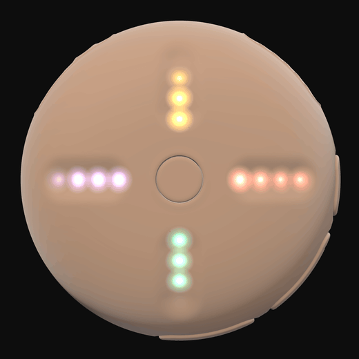
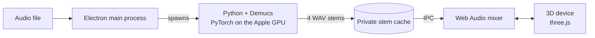

<h1 align="center">Stem Player</h1>

<p align="center">
  
</p>

<p align="center">
  <b>Split any song into vocals, drums, bass and instrumental, then remix it live on a 3D stem player.</b><br>
  Everything runs on your Mac. Nothing is uploaded.
</p>

<p align="center">
  <a href="https://github.com/PravdeepK/stem-player/releases/latest"></a>
  <a href="https://github.com/PravdeepK/stem-player/actions/workflows/ci.yml"></a>
  
  
  
  
</p>

<p align="center">
  <a href="#install">Install</a> ·
  <a href="#using-it">Using it</a> ·
  <a href="#how-it-works">How it works</a> ·
  <a href="#development">Development</a>
</p>

## Features

- **Stems from any song.** Drop in an mp3, wav, flac, m4a or mp4 and [Demucs] splits it into
  vocals, drums, bass and instrumental. It runs on the Apple GPU, and falls back to the CPU
  automatically if a GPU run fails.
- **A 3D recreation of the hardware as the mixer.** The device is modelled in Blender and
  drawn live with three.js. Slide a groove to set a stem's level, tap to mute, hold the end to
  solo, and drag the device to turn it in your hand.
- **Sample-locked playback.** All four stems play from one shared clock in the Web Audio
  graph, so they never drift, with seeking and a waveform per stem.
- **Feel the beat.** Optional beat taps pulse the Force Touch trackpad on each drum hit, found
  ahead of time from the drums stem. Turning the volume down lets only the harder hits through.
- **Instant reopen.** Separated songs live in a private cache, recognised by their audio rather
  than their filename, so a song you've done before opens straight away. **Export Stems…**
  writes the four WAVs wherever you want them.

## Install

You need a Mac with Apple silicon (M1 or later). Paste this into Terminal:

```sh
curl -fsSL https://raw.githubusercontent.com/PravdeepK/stem-player/main/install.sh | bash
```

That downloads the [latest release](https://github.com/PravdeepK/stem-player/releases/latest),
puts **Stem Player** in Applications and opens it. Run the same line again to update.

The first time you make stems, the app offers a one-time download of its stem engine
(Python, PyTorch and Demucs: about 180 MB, about 750 MB on disk). Making stems needs
macOS 14 or later. **Stem Player → Remove Stem Engine…** gives the space back.

<details>
<summary>Downloaded the zip in a browser instead?</summary>

The app isn't notarized by Apple, so macOS blocks it the first time. Move it to Applications
and open it once, then go to **System Settings → Privacy & Security** and click
**Open Anyway**. Or clear the flag in Terminal:

```sh
xattr -dr com.apple.quarantine "/Applications/Stem Player.app"
```

</details>

<details>
<summary>Uninstall</summary>

Quit the app, then delete it along with its settings, stem cache and stem engine:

```sh
rm -rf "/Applications/Stem Player.app" ~/Applications/"Stem Player.app"
rm -rf ~/Library/Application\ Support/Stem\ Player
```

</details>

## Using it

1. Open the menu with the plain pill on the device, or the ☰ in the top-left.
2. Next to **Song**, click **Choose…** and pick a track.
3. Pick a **Quality**: **Fast** (the default) or **Best**, which is cleaner but takes about
   four times as long.
4. Click **Separate**. Progress shows under the device, so you can close the menu meanwhile.
5. The stems load into the device when they're ready, and the song appears under **Recent**.

| On the device | What it does |
| --- | --- |
| Grooves | Slide for that stem's volume, tap to mute. Hold the outer end to hear the stem alone until you let go; double-click or Option-click for a solo that stays on. Vocals top, drums right, instrumental bottom, bass left. |
| Centre button | Play / pause |
| − / + pill | Master volume |
| Dot pill | Jump 10 seconds back or forward. Hold to keep scrubbing. |
| Plain pill | Open or close the menu |
| Anywhere else | Drag to turn the device. Double-click the background to bring it back head-on. |

Every part of the device can also be reached with Tab; its control appears while it has focus.
**Open Stems Folder…** loads any folder containing `vocals`, `drums`, `bass` and
`instrumental` WAVs.

## How it works



- **Separation.** The Electron main process runs [`python/separate.py`](python/separate.py),
  a thin Demucs wrapper that streams progress back as JSON lines. **Fast** is `htdemucs`
  (about 80 MB of weights). **Best** is `htdemucs_ft`, four fine-tuned models of about 1 GB
  in total. Each model downloads once, on first use. Demucs' `other` stem is renamed
  `instrumental`.
- **GPU or CPU.** The menu's **Processor** setting defaults to the GPU where Demucs can use
  it, which was about 40% faster on Fast in testing with no change in the stems. If a GPU
  run fails, for example running out of memory on a long song, it starts over on the CPU.
- **The stem engine.** On a Mac without a suitable Python, the app installs its own: a pinned
  [uv] release, with its checksum checked, fetches a standalone Python 3.13, PyTorch and
  Demucs into the app's data folder. The engine is built in a staging folder and only goes
  live once it can import Demucs, so a failed or cancelled download never leaves a broken
  engine behind.
- **The cache.** Songs are keyed by a hash of their audio and the model used. The oldest
  are cleared once the cache passes 2 GB.
- **The device.** [`blender/build_stem_player.py`](blender/build_stem_player.py) generates
  the model, and [`lib/deviceScene.js`](lib/deviceScene.js) renders it with three.js outside
  React's render cycle. It only draws while something is moving, so an idle device costs
  nothing during playback.
- **Haptics.** A small native addon ([`native/haptics`](native/haptics)) drives the trackpad's
  haptic engine.

## Development

### Requirements

- macOS on Apple silicon
- Node 18 or later (developed on 22)
- Optional: Python 3 with `demucs` (`python3 -m pip install --user demucs`). Without it,
  the app offers to download its own stem engine, as in a release build.

### Run it

```sh
npm install
npm run build:native   # trackpad haptics; the app runs without it, minus the taps
npm run dev            # Next.js dev server on :3001 with Electron pointed at it
```

`npm start` builds the static export into `out/` and runs Electron against it instead.

### Scripts

| Command | What it does |
| --- | --- |
| `npm run dev` | Development, with hot reload |
| `npm start` | Static export, run from disk like the packaged app |
| `npm test` | Unit tests |
| `npm run test:e2e` | The real app driven with real input (needs ffmpeg and Demucs). Builds the static export first. |
| `npm run test:e2e:gpu-fail` | The same, with every GPU run failing, to prove the CPU fallback |
| `npm run icons` | Rebuilds every app icon from the SVG masters in `assets/icon/` |
| `npm run pack` | A local `Stem Player.app` in `dist/` |
| `npm run release:mac` | The release zip that the installer downloads |
| `blender -b -P blender/build_stem_player.py` | Rebuilds `assets/models/stem-player.glb` |

### Configuration

Copy `.env.example` to `.env` (it's gitignored). Both values are optional:

- `STEM_PLAYER_PYTHON` forces a specific Python interpreter. Otherwise the app tries
  `python3` on PATH, Homebrew and the python.org builds, then its own stem engine.
- `HF_TOKEN` is a Hugging Face read token. It raises the model-download rate limit and
  silences the "unauthenticated requests" warning.

### Project layout

```
electron/     main process: separation, stem cache, stem engine, IPC, menu
pages/        Next.js renderer (exported statically into out/)
components/   React UI around the device
hooks/        audio mixer, stem controls, beat taps
lib/          three.js device scene, groove gestures, beat detection
python/       the Demucs wrapper
blender/      script that generates the 3D model
native/       haptics addon
scripts/      icon and README media builds
test/         unit and end-to-end tests
```

<details>
<summary>Publishing a release</summary>

GitHub Actions builds and publishes a release when you push a version tag:

1. Bump `version` in `package.json` (for example to `0.2.0`) and commit it.
2. Tag the commit and push both:

   ```sh
   git tag v0.2.0 && git push origin main --tags
   ```

The [release workflow](.github/workflows/release.yml) runs on an Apple silicon runner.
It checks that the tag matches `package.json`, runs the tests, builds the haptics addon
and builds `Stem-Player-mac-arm64.zip` (ad-hoc signed, not notarized). Then it checks the
signature and publishes the release with generated notes. The zip has the same name
every time, so the installer's `releases/latest/download/` link always gets the newest
one. A tag with a suffix, like `v0.2.0-beta.1`, becomes a prerelease, which the installer
skips.

To build the same zip locally instead:

```sh
npm run build:native   # without it, the zip ships without the haptics addon
npm run release:mac    # re-renders the icons, then builds dist/Stem-Player-mac-arm64.zip
```

Don't upload the `npm run pack` or `npm run dist` builds; they're signed with whatever
certificate is in your keychain.

To try the installer without publishing, point it at a local zip and a scratch folder:

```sh
STEM_PLAYER_ZIP=dist/Stem-Player-mac-arm64.zip STEM_PLAYER_INSTALL_DIR=/tmp/apps bash install.sh
```

</details>

## Roadmap

- A web version that runs in the browser, with no install.

## Credits

- [Demucs] by Alexandre Défossez at Meta AI does the separation.
- [three.js](https://threejs.org), [wavesurfer.js](https://wavesurfer.xyz),
  [Electron](https://www.electronjs.org), [Next.js](https://nextjs.org) and [uv].
- The device is modelled after the Stem Player hardware by Kano. This is an independent,
  non-commercial fan project, not affiliated with or endorsed by Kano or Ye.

Built by [PravdeepK](https://github.com/PravdeepK) ·
[LinkedIn](https://www.linkedin.com/in/pravdeepk/)

[Demucs]: https://github.com/adefossez/demucs
[uv]: https://github.com/astral-sh/uv
